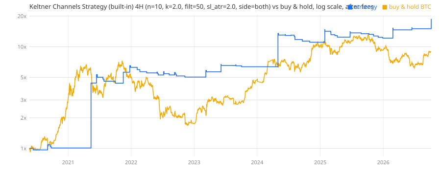

# BTC/USDT.P Chart Dashboard

A single-file dashboard (`index.html`) that shows the BTCUSDT perpetual in nine chart styles at once:
candlestick + volume, hollow candles, Heikin Ashi, OHLC bars, line with EMA 20/50, area, baseline,
step line and Renko.

- Live data from Binance USDⓈ-M Futures, falling back to OKX (BTC-USDT-SWAP) if Binance is blocked,
  and to demo data if neither is reachable. Refreshes every 3 seconds.
- Intervals: 1m, 5m, 15m, 1h, 4h, 1D. Light / dark / auto theme.
- Pan or zoom one chart and the others follow.

Open `index.html` in a browser — no build step. Charts use TradingView Lightweight Charts from a CDN.

## ETF (`flow-radar.html`)

A BTC perpetual chart with a VPVR volume profile and daily ETF inflow/outflow, styled to match the ATLAS Suite boards.

- A VPVR (volume profile of the visible range) sits inside the chart: blue = volume from candles that
  closed up, yellow = closed down, brighter rows = 70% value area, red line = point of control (POC).
  Toggle it with the VPVR button. The boxes at the top show the POC, value area high/low and open interest.
- Buttons switch the chart timeframe (5M, 15M, 1H, 4H).

### ETF inflow/outflow panel

Under the chart, with a BTC / ETH / SOL switch: daily net flows for the US spot Bitcoin, Ether or Solana ETFs (all funds combined), cumulative net inflow,
5- and 20-day totals, net assets, coins held, and a per-fund table (IBIT, FBTC, ... / ETHA, FETH, ... / BSOL, FSOL, ...). Data comes from
SoSoValue's public API.

- Opened as a file, the page reads SoSoValue directly and checks for new data every 30 minutes.
- On the hosted claude.ai page, which cannot reach SoSoValue, a daily scheduled job runs
  `scripts/etf_flows.py` for btc, eth and sol and saves the results to the page's `etf/btc`, `etf/eth` and
  `etf/sol` database documents. SoSoValue has no data for other coins' ETFs (XRP, DOGE, LTC, ...).

## Liquidity Map (`liquidity-map.html`)

Where open orders sit around the BTC perpetual price: 1H candles with three side profiles on one price axis.

- **Limit orders** (real): the visible order books of OKX, Binance, Deribit, Gate and Hyperliquid BTC perps,
  in USD per price bucket, stacked per exchange. Each book only reaches as far as the exchange returns
  (OKX ±0.8%, Hyperliquid ±2.4% in $100 blocks, Gate ±3.5%, Binance 1000 levels, Deribit the full book).
- **Stops** (estimate): no exchange publishes stop orders. Placed just above unswept swing highs (buy stops) and
  below unswept swing lows (sell stops), weighted by volume around the swing and recency (half-life 1 week), plus a
  small weight on round $1000 levels. Shown as a 0–100 score.
- **Liquidations** (estimate): hourly OKX open-interest increases opened at that hour's average price, split
  long/short by where the candle closed, at 10× / 25× / 50× / 100× (35 / 30 / 20 / 15%). Levels price already hit are
  removed; falling OI scales everything down. Amounts are OKX only.
- Range ±1.5–12%, bucket $25–$500 or Auto (default: $50 / $100 / $250 / $500 for ±1.5 / 3 / 6 / 12%),
  exchanges can be switched off. Hover a level for the per-exchange breakdown.
  A table lists the 4 largest levels of each kind above and below the price.

A **Reading** block at the top describes the chart in words and gives a direction score from −100 to +100, recomputed
on every data update (fixed $100 buckets, ±6%, all exchanges, so it does not change with the view):

| Factor | Signal (−1 … +1) | Weight |
|---|---|---|
| Momentum | ½·tanh(24h return / 2%) + ½·tanh((EMA20 / EMA50 − 1) / 0.4%) on 1H | 30% |
| Order book | 0.6 × bid/ask imbalance within ±0.5% + 0.4 × within ±1% | 25% |
| Liquidity pull | (above − below) / (above + below) of stop score + liquidation size per level, divided by distance in % | 30% |
| Open interest | 24h OI change: rising OI counts with the price move (±1 at 3%), falling OI half against it | 15% |

≥ +25 up, +10 … +25 slightly up, −10 … +10 neutral (and mirrored). It also lists the down / up scenario (nearest
wall to break, then the largest stop or liquidation cluster within one average day's range) and that range
(mean high − low of the last 14 days). It is arithmetic on current orders, not a forecast; not backtested.

Opened as a file it refreshes the books every 15 seconds. The hosted claude.ai page cannot reach the exchanges and
shows the snapshot embedded by `scripts/liquidity_snapshot.py` (run it again to refresh the snapshot).

## Delta Volume indicator (`indicators/delta_volume.pine`)

TradingView indicator for BTCUSDT.P (works on any symbol): buy volume − sell volume per bar, and the
cumulative delta (CVD).

- Pine Script cannot see which side started each trade, so delta is estimated from 1-minute candles inside each
  bar (like TradingView's built-in Volume Delta): a 1m candle that closed up counts as buy volume, one that closed
  down as sell volume, a flat one takes the direction of the last price move.
- Show: delta candles (body = bar delta, wicks = highest / lowest delta inside the bar), delta columns, or CVD
  candles, with an EMA. CVD can reset each day, week or month.
- Volume in BTC or in USDT. A table shows buy / sell volume, delta, delta % and CVD for the last bar.
- Older bars beyond TradingView's intrabar history use the chart candle instead (buy share = (close − low) / (high − low))
  and are drawn faded.
- Price / CVD divergence: bullish when price makes a lower low but CVD a higher low, bearish when price makes a
  higher high but CVD a lower high (hidden divergences optional). Found on price pivots (5 bars left, 3 right, 5–60
  bars apart), so a signal shows 3 bars after the pivot. Drawn as lines and labels on the candles, a line on the CVD
  (in CVD mode) and triangles in the pane. Pivot pairs with a CVD reset in between are skipped.
- Buy / sell signals when a divergence confirms: after a bullish divergence, BUY when a candle closes above the
  highest high since the pivot low, with positive delta. Cancelled if price breaks the pivot low first, if a bearish
  divergence appears, or after 10 bars. SELL is the mirror image. The pending trigger level is drawn on the chart.
  The pivot is the natural stop; it is included in the `alert()` message. Not backtested.
- Alerts: delta turns positive / negative, CVD crosses its EMA, each divergence type, buy / sell.

Add it: TradingView → Pine Editor → paste the file → Add to chart, on `BINANCE:BTCUSDT.P` or `BYBIT:BTCUSDT.P`.

### Backtest of the BUY / SELL signals (`scripts/cvd_divergence_backtest.py`)

Default settings, Binance BTCUSDT.P 1m candles Oct 2020 – Sep 2026, next-bar-open entry, stop at the divergence
pivot (checked on 1m), opposite signal reverses, 1×, 0.075% cost per side. Full tables:
[`backtests/cvd_divergence.md`](backtests/cvd_divergence.md).

| Chart | Trades / yr | PF (no target) | Net (no target) | PF (2R target) | Net (2R target) | Max DD |
|---|---|---|---|---|---|---|
| 5m | 700 – 796 | 0.61 | −100% | 0.62 | −100% | 100% |
| 15m | 206 – 241 | 0.91 | −71% | 0.93 | −59% | 67 – 73% |
| 1H | 48 – 55 | 0.81 | −75% | 0.74 | −78% | 79 – 83% |
| 4H | 12 – 15 | 0.69 | −69% | 0.96 | −28% | 55 – 69% |
| 12H | 3 – 4 | 0.54 | −47% | 1.49 | +40% | 32 – 64% |
| 1D | 3 | 1.17 | −16% | 0.89 | −34% | 68 – 69% |
| Buy & hold | | | +676% | | | |

- Every timeframe loses after costs except 12H with the 2R target (+40% in 6 years, 25 trades, PF 1.49): too few
  trades to trust, and the same timeframe without a target loses 47%. 5m loses everything (PF 0.61, ~750 trades a
  year). 15m has a small edge before costs (PF 1.12 – 1.18) that fees remove.
- SELL signals lose on every timeframe but 12H (PF 0.39 – 0.90). BUY signals alone do better on 4H / 1D (PF 1.3+), but
  that is 34 trades in 6 years on 4H and 4 on 1D: too few to rely on.
- With Binance's real taker delta instead of the estimate, 4H makes +23% to +34% in 6 years: still far below holding.
- The estimate from the chart candle, which TradingView uses for bars older than its intrabar history, gives
  different signals (PF 0.35 – 1.21), so signals in the indicator's older history do not show what it does live.

Filters and exits, ranked on train (Oct 2020 – Dec 2023), judged on test (Jan 2024 – Sep 2026):
[`backtests/cvd_divergence_improve.md`](backtests/cvd_divergence_improve.md) (`scripts/cvd_divergence_improve.py`).

- 240 rule sets (chart × long only or both × EMA 200 / daily EMA 200 trend filter × target × min stop): 72 profitable
  on train, 11 on test, 5 on both. The trend filters raise the train PF (1.13 – 1.15 median) and lower the test PF
  (0.76 – 0.79): they fit the 2020 – 2023 swings, not a lasting edge. The best train rule set (15m, long only, daily
  EMA 200, PF 2.04) has test PF 0.75.
- Long only is a little better than both sides (median test PF 0.84 vs 0.77). Targets and a minimum stop change little.
- The intrabar timeframe for delta matters on 4H: with 15m or 1H intrabars instead of 1m, 4H is profitable on both
  train and test (PF 1.15 – 2.04 train, 1.16 – 1.66 test, 35 – 64 trades each). On 15m, 1H and 1D coarser intrabars
  do not help, and on 4H the result swings from PF 0.40 to 1.66 with that one choice: a fragile edge.

With 1H intrabars on 2H – 1D charts (indicator: Auto lower timeframe off, Lower timeframe 1 hour):
[`backtests/cvd_divergence_1h.md`](backtests/cvd_divergence_1h.md) (`scripts/cvd_divergence_1h.py`).

| Chart | Exit | Trades / yr | PF | Net (6 yr) | Max DD | Train PF | Test PF |
|---|---|---|---|---|---|---|---|
| 2H | no target | 32 | 1.33 | +115% | 63% | 1.15 | 1.78 |
| **4H** | **no target** | **15** | **1.74** | **+274%** | **39%** | **2.04** | **1.21** |
| 4H | 2R | 19 | 1.31 | +85% | 36% | 1.39 | 1.16 |
| 6H – 1D | either | 2 – 9 | 0.15 – 1.44 | −75% to +70% | 48 – 80% | | |

- 4H with 1H intrabars is the best result so far, but most of it came in 2021 – 2022 (+82%, +123%); 2023 – 2026 was
  −16%, +12%, +6%, −8%. It was also picked after seeing the intrabar test, so expect worse live. Buy & hold: +676%,
  with a deeper drawdown (~77%).
- With 1H intrabars TradingView has intrabar data for the whole chart history, so the indicator's past signals on 4H
  match this backtest (with 1m intrabars only the last few weeks do).

Bybit check ([`backtests/cvd_divergence_bybit.md`](backtests/cvd_divergence_bybit.md), `scripts/cvd_divergence_bybit.py`,
Bybit 15m candles from `scripts/bybit_data.py`, stops checked on 15m):

| Data | Chart | Exit | Trades / yr | PF | Net (6 yr) | Max DD | Train PF | Test PF |
|---|---|---|---|---|---|---|---|---|
| Binance | 4H | no target | 15 | 1.74 | +274% | 39% | 2.04 | 1.21 |
| **Bybit** | **4H** | **no target** | **13** | **1.91** | **+326%** | **47%** | **2.20** | **1.41** |
| Bybit | 4H | 2R | 17 | 1.33 | +82% | 46% | 1.49 | 1.06 |
| Bybit | 2H / 6H | either | 9 – 32 | 0.70 – 1.19 | −63% to +11% | 53 – 80% | | |

- 4H holds on Bybit; 2H and 6H do not (2H made +115% on Binance, −54% on Bybit). Bybit 4H by year: +35% (2021),
  +220% (2022), −24%, +42%, −10%, −6% (2026): most of the gain is again 2022.
- TradingView version: [`strategies/cvd_divergence_4h.pine`](strategies/cvd_divergence_4h.pine) (delta from 1H
  intrabars, stop at the pivot, opposite signal reverses, 0.075% commission per side, trades from Oct 2020).

## EMA Ribbon flip backtest (`scripts/ribbon_backtest.py`)

Backtest of trading BTCUSDT.P on the flips of the **EMA Ribbon [Krypt]** (EMAs 20–55): long when all 8 EMAs
turn bullish in order, short when they turn bearish, reversed on the opposite flip. Tested on 5m, 15m, 30m, 1H,
2H, 4H, 6H, 12H and 1D, in four variants. Full tables: [`backtests/ema_ribbon_flip.md`](backtests/ema_ribbon_flip.md).

Squeeze variant (flip after the EMAs were on one line, 2.5 × ATR stop), 1×, after fees:

| Chart | Last 2 years | Aug 2020 – Sep 2026 | Trades / year | Worst year | Max drawdown (2020–26) |
|---|---|---|---|---|---|
| 5m – 2H | −42% to −97% | — | 55 – 1,300 | — | — |
| 4H | +102% | +371% | ~24 | −8% | 45% |
| 6H | +57% | +1,168% | ~16 | −34% (2022) | 35% |
| **12H** | **+97%** | **+912%** | **~9** | **−9% (2022)** | **40%** |
| 1D | +15% | +384% | ~4 | −18% (2024) | 49% |
| Buy & hold | +32% | +607% | | −64% (2022) | |

- Below 4H the strategy loses money. Fees eat the edge (5m: +63% before costs, −97% after).
- 12H is the most consistent: highest profit per unit of loss (profit factor 3.25) and small losing years.
- Daily flips too late on 20–55-day EMAs and gives only ~4 trades a year.
- Much of the 2020–26 gain came from the late-2020 rally; from 2021 on, 12H made about +220% vs +191% for holding.
- The variant was picked after seeing the results, so expect worse live. Past results do not predict future ones.

Run it: `python3 scripts/ribbon_backtest.py` (downloads candles into `data/`, ~10 minutes the first time).

## Liquidity Trail Signals settings search (`scripts/liquidity_trail_backtest.py`)

Backtest of **Liquidity Trail Signals [BOSWaves]** on BTCUSDT.P: 780 settings (MA Length × ATR Length × Trail
Distance) × 13 exit/entry variants on 15m – 1D, 1×, after fees. Settings are picked on 2020 – Oct 2024 and checked on
Oct 2024 – Oct 2026. Only MA Length, ATR Length, Trail Distance, Entry Mode and the TP R values change the signals; the
zone, label and extend inputs are drawing options. Full tables: [`backtests/liquidity_trail_signals.md`](backtests/liquidity_trail_signals.md).

| Chart | MA / ATR / Trail | 2020–26 | Buy & hold | Max drawdown | Last 2 years (B&H +39%) | Trades / year |
|---|---|---|---|---|---|---|
| **12H** | **200 / 10 / 1.0** | **+1,114%** | +848% | 49% (B&H 77%) | **+95%** | ~7 |
| 6H | 200 / 10 / 1.0 | +1,743% | +1,187% | 50% | +84% | ~15 |
| 4H | 200 / 10 / 1.25 | +1,427% | +798% | 45% | +60% | ~20 |
| 4H | 28 / 15 / 1.25 (default) | +131% | +798% | 58% | −24% | ~56 |

- Signal Change entry, exit on the opposite flip (the trail at entry as the stop). TP1–3 exits do worse, and Trail
  Retest mode rarely triggers.
- The default settings lose money below 12H after fees. MA 150–200 is what works on 4H – 12H; ATR Length barely matters.
- 200 is the indicator's maximum MA Length, and 12H gives only ~40 trades in six years. Past results do not predict future ones.

Run it: `python3 scripts/liquidity_trail_backtest.py` (reuses `data/` from the ribbon backtest, ~10 minutes).

## High-frequency strategy search, Bybit data (`scripts/pf_search.py`, `scripts/rsi_pullback.py`)

Goal: a good profit factor with at least 250 trades a year on BYBIT BTCUSDT.P, on 15m, 1H, 4H, 12H and 1D.
Candles come from Bybit's public file server (`scripts/bybit_data.py`: MT4 15m candles to Nov 2024, then candles
built from Bybit's trade files; Bybit's REST API is geo-blocked here). Train Apr 2020 – Oct 2024, test Oct 2024 – Oct 2026.

`pf_search.py` tests ~7,600 variants per timeframe: own strategy types (RSI and Bollinger mean reversion, liquidity
sweeps, Donchian breakouts, opening-range breakouts, time of day, volume spikes, Liquidity Trail) and 14 community or
built-in TradingView strategies (UT Bot, Range Filter, Chandelier Exit, Supertrend, SSL Channel, Squeeze Momentum,
MACD, RSI, Bollinger, Keltner, Parabolic SAR, Hull, MA cross, Stochastic). Full tables: [`backtests/pf_search.md`](backtests/pf_search.md).

- **With market orders (taker 0.055% + slippage), nothing with 250+ trades a year gets above PF ~1.0 on the test
  window, on any timeframe.** The community strategies land at test PF 0.6 – 0.99. Fees are the problem: 250 round trips
  cost ~37% a year.
- 12H and 1D cannot reach 250 trades a year (730 / 365 candles a year).
- Mean reversion entered with **limit orders** (maker 0.02%) is the one thing that holds up.

`rsi_pullback.py` re-tests that with realistic fills (a limit fills only if price trades through it; stops and time
exits pay taker + slippage). Full tables: [`backtests/rsi_pullback.md`](backtests/rsi_pullback.md).

| 1H RSI(3) pullback, limit orders | Train 2020–24 | Test 2024–26 | Whole period |
|---|---|---|---|
| Profit factor | 1.14 | 1.11 | 1.13 |
| Trades / year | 256 | 268 | 260 |
| Win rate | 70% | 67% | 69% |
| Return / max drawdown | +69% / 20% | +15% / 11% | +95% / 20% |

Rules: RSI(3) < 25 and close > EMA 50 → buy limit 0.1 × ATR below the close (one candle); stop 3 × ATR; when RSI(3)
closes above 50, sell limit at that close, else at market next candle; max 48 candles. Shorts mirrored. Every year
2020 – 2026 had PF ≥ 1.00 (2023 flat). The edge is thin (~11% a year): it depends on limit fills, and with all-taker
fees it loses. TradingView version: [`strategies/rsi_pullback_limit.pine`](strategies/rsi_pullback_limit.pine).

## Best community strategy (`scripts/community_backtest.py`, `scripts/community_detail.py`)

16 TradingView community and built-in strategies (UT Bot, Range Filter, Chandelier Exit, Supertrend, SSL Channel, Squeeze
Momentum, HalfTrend, QQE MOD, Hull Suite and the built-in MACD, RSI, Bollinger, Keltner, Parabolic SAR, MA cross and
Stochastic strategies) on Bybit BTCUSDT.P, 15m – 1D, ~8,800 variants per timeframe: wide settings grids, with or without
an EMA trend filter, an ATR stop and long-only. Taker fees + slippage, 1x. Picked on Apr 2020 – Oct 2024, checked on
Oct 2024 – Oct 2026. Full tables: [`backtests/community_strategies.md`](backtests/community_strategies.md).

**Winner: Keltner Channels Strategy (TradingView built-in, close-based breakout)**: bands EMA 10 ± 2 × EMA(high − low, 10),
only longs above the 50 EMA and shorts below it, 2 × ATR stop. Full backtest: [`backtests/4H_keltner_tv.md`](backtests/4H_keltner_tv.md).

| 4H chart | Train 2020–24 | Test 2024–26 | Whole period | Buy & hold |
|---|---|---|---|---|
| Profit factor | 5.89 | 2.54 | 4.92 | |
| Trades / year | 10 | 10 | 10 | |
| Win rate | 33% | 30% | 32% | |
| Return | +1036% | +65% | +1779% | +804% |
| Max drawdown | 23% | 17% | 23% | 77% |

- The same settings make money on unseen data on **every** chart from 1H to 1D (test PF 1.35 – 8.3; 3H – 8H: 2.5 – 3.1),
  so the edge does not depend on one candle size.
- Trend following: ~1 in 3 trades wins; longs carry it (PF 8.1, shorts 1.3). Losing years: 2022 (−20%) and 2025 (−17%).
- First pick was the Bollinger Bands Strategy on 4H (PF 2.9 in both windows, no losing year), but it fails on 1H, 2H and 8H
  with the same settings: the 4H result is a lucky spot. Report kept in [`backtests/4H_bb_tv.md`](backtests/4H_bb_tv.md).
- TradingView version: [`strategies/keltner_trend_4h.pine`](strategies/keltner_trend_4h.pine). The strategies use
  `margin_long/short = 50`: with 100% of equity per trade, Pine v6's default 100% margin makes TradingView force-close
  parts of positions ("Margin call" trades) once commission is paid, which adds losing trades the backtest does not have.

## Chandelier Exit (everget) as a strategy (`scripts/chandelier_backtest.py`)

Long on Buy, short on Sell, always in the market, Bybit BTCUSDT.P, 1H – 1D, 72 settings (ATR length × multiplier ×
close or high/low extremes), both sides and long-only. Full tables: [`backtests/chandelier_exit.md`](backtests/chandelier_exit.md).

| Default 22 / 3.0, test Oct 2024 – Oct 2026 | 1H | 2H | 3H | 4H | 6H | 8H | 12H | 1D |
|---|---|---|---|---|---|---|---|---|
| Both sides, PF | 0.83 | 0.82 | 0.99 | 0.87 | 0.89 | 1.42 | 0.89 | 1.34 |
| Long only, PF | 0.92 | 0.95 | 1.18 | 1.07 | 1.13 | 1.82 | 1.18 | 1.38 |

- As a long/short system it does not work: below 1D, 76 – 100% of all settings lose on the test window. The shorts
  are the problem; long-only is mostly profitable from 4H up, but still made far less than holding BTC (4H: +313% vs
  +804% over 2020 – 26).
- 8H with the defaults looks good (test PF 1.42, long-only 1.82) but 6H and 12H next to it do not: likely luck.
- It is built as a trailing stop, and that is what it is good for, not as an entry signal.
- TradingView version: [`strategies/chandelier_exit_strategy.pine`](strategies/chandelier_exit_strategy.pine).

### Chandelier Exit on 1D: best ATR period × multiplier (`scripts/chandelier_1d.py`)

22 ATR periods (2 – 60) × 21 multipliers (1.0 – 6.0), close or high/low extremes, both sides or long only. Full grids:
[`backtests/chandelier_1d.md`](backtests/chandelier_1d.md). The multiplier matters far more than the ATR period:
4.0 – 4.5 works for almost every period in both windows, 3.5 and below mostly does not.

| ATR 40, multiplier 4.0, close | Train 2021–24 | Test 2024–26 | Whole period (from Jan 2021) | Buy & hold |
|---|---|---|---|---|
| Long + short | PF 2.57 | PF 2.92 | PF 2.63, +450%, DD 32%, 32 trades | +164% |
| Long only | PF 5.40 | PF 2.94 | PF 4.83, +434%, DD 19%, 16 trades | +164% |

Only ~16 – 32 trades in six years, so the numbers are fragile; dropping the multiplier to 3.5 breaks it.

### Chandelier Exit + ZLSMA 38 (`scripts/chandelier_zlsma.py`)

ZLSMA (veryfid's Zero Lag LSMA) as a filter (Buy only above it, Sell only below), as a confirmation, and as an extra
exit, on 15m – 1D. Full tables: [`backtests/chandelier_zlsma.md`](backtests/chandelier_zlsma.md).

- It does not fix the low timeframes: 15m and 1H still lose money in every variant (test PF 0.5 – 0.96).
- Exiting when price closes back through ZLSMA makes almost every case worse (it cuts the trend trades short).
- As a pure filter it helps a little in some cases (4H 40 / 4 long-only: test PF 1.21 → 1.50, +739% → +1002% over
  2020 – 26; 1D 40 / 4 long-only: same test PF, max drawdown 19% → 14%) and hurts in others (12H 40 / 4, 1D 22 / 3).
- 38 is not special: test PF jumps around between ZLSMA 20, 32, 38, 50, 75 and 100 with no pattern.

### + MACD as a third filter (`scripts/chandelier_zlsma_macd.py`)

MACD 12 / 26 / 9 must agree with the Chandelier signal, either "MACD line above 0" or "MACD above its signal line", on
its own or together with ZLSMA 38. Full tables: [`backtests/chandelier_zlsma_macd.md`](backtests/chandelier_zlsma_macd.md).

- "MACD above 0" helps; "above the signal line" barely changes anything.
- Chandelier 22 / 3 + ZLSMA 38 + MACD > 0 on 4H: test PF 1.07 → 1.56 long-only (max drawdown 39% → 20%) and
  0.87 → 1.43 long + short. It holds for other ZLSMA lengths (20 – 75) and MACD settings (test PF 1.25 – 2.29), and on
  4H – 12H, but fails on 2H and 3H; with fewer trades it makes less in total than Chandelier alone (4H long +185% vs +313%).
- Still well below the Keltner breakout above. The filters are options in
  [`strategies/chandelier_exit_strategy.pine`](strategies/chandelier_exit_strategy.pine).

## TradeBot check (`scripts/tradebot_stress.js`)

Independent check of [TradeBot](https://alicetin1905-ux.github.io/TradeBot/) using its own backtest code with
realistic fills switched on, plus the same rules on 21 coins it did not pick. Full report:
[`backtests/tradebot_review.md`](backtests/tradebot_review.md).

| 2020 – 2026, from 2,000 USDT | End | PF | Max drawdown |
|---|---|---|---|
| Bot's 21 coins, its backtest | 64,765 | 1.40 | 28.6% |
| Bot's 21 coins, realistic fills | 56,062 | 1.34 | 29.3% |
| 21 other liquid alts, its backtest | 10,320 | 1.05 | 70.4% |
| 21 other liquid alts, realistic fills | 1,469 | 0.99 | 89.1% |

The backtest reproduces and survives realistic fills, but on coins it was not tuned on it does not make money: most
of the edge comes from picking the coins after seeing the results.
